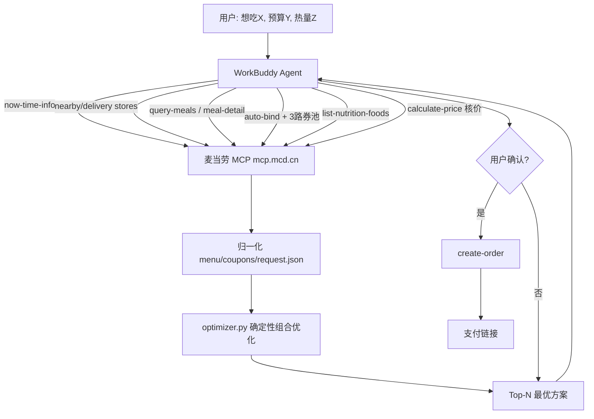

# Harvest brief, 2026-10-15

14 items shortlisted from 287 candidates (142 dropped as already seen, 14 carry a vault verdict on the vendor).

## 1. [vault] signal-timed outreach
key: vault:2026-10-15:signal-timed-outreach
url: https://www.altahq.com
meta: {"vault_status": "open", "kind": "tool", "subject": "Alta (altahq.com) AI SDR agents", "date": "2026-10-15", "where": "TRITON-CORE/Research/links/2026-10-15-altahq-ai-sdr.md", "has_transcript": false}
query: open
VAULT THREAD, status open: one theme split out of a link Luke sent the vault. Judge the idea on its own: what the mechanism is, how it would be done, what tools it needs. The vault's status and note are context about the vendor and about Luke's time, not a verdict on the idea. Keep it unless the mechanism itself is unlawful or crosses the charter line (fraud services, stolen data, impersonation, explicit deepfakes of real people, unlicensed gambling). Lens is mechanism.

Vault status: open, meaning nobody on the vault side has run it to a verdict.

The vault's note on this theme: cheap local signals as the why-now in cold email

The vault's verdict on the parent link, which judged the vendor and Luke's time, not this theme: (tool) Not for us now: US B2B team tool, quote-only, est 24k-60k USD a year; AI cold calls and LinkedIn automation clash with UK rules and platform terms. Use as a blueprint: inbound reply, no-show and closed-lost revival are sellable client products. Write-up: `TRITON-CORE/Research/links/2026-10-15-altahq-ai-sdr.md` Link: https://www.altahq.com

## 2. [hn] Why We're Banning AI
key: hn:50108131
url: https://www.currentaffairs.org/news/why-were-banning-ai
discussion: https://news.ycombinator.com/item?id=50108131
meta: {"points": 212, "comments": 165, "created": "2026-10-15T18:32:29Z"}
query: bonding curve

comment (kolinko): I kind of respect that. Ok using AI for researching and whatnot, and for their core thing which is writing and illustrations using human work.
comment (georgemcbay): Good. AI is great for some things. It is not currently great (or even remotely passable) at writing interesting magazine articles.
comment (hisfraudulency): I'm kinda ambivalent on the Druckenmiller WSJ case. He's admittedly a poor writer, and probably wouldn't have published anything had it not been for AI. Obviously the WSJ staff shouldn't be using it in the final output, but if it's a prominent guest's opinion filtered through ChatGPT, I'm mostly fine with it.

## 3. [github] hujjun/mcd-saver-strategist: 麦当劳省钱点餐助手（麦门精算师）｜麦当劳优惠券组合优化 Skill：拉取麦当劳菜单与全部可用优惠券，算出最省的点餐组合，巨无霸套餐 ¥47 → ¥21.9（省 53%）。McDonalds MCP（麦当劳 MCP）coupon optimizer · McDonalds China MCP Server · Agent Skill for WorkBuddy · 麦当劳程序员创意开发大赛参赛作品
key: gh:hujjun/mcd-saver-strategist
url: https://github.com/hujjun/mcd-saver-strategist
meta: {"stars": 428, "created": "2026-10-09", "pushed": "2026-10-10", "language": "Python", "topics": ["agent-skill", "ai-agent", "coupon-optimizer", "coupons", "deterministic-optimization", "fast-food", "mcd", "mcdonalds"]}
query: mcp server created:>{since} stars:>30

# 麦门省钱精算师 · mcd-saver-strategist

> 基于 **麦当劳中国 MCP（McDonald's China MCP）** 开发的省钱点餐 Skill / AI 智能体技能：
> 把「菜单 × 优惠券 × 叠加规则」的组合优化交给确定性算法，
> 让每一顿麦麦都点得明明白白、省得清清楚楚。
> 又名：麦门省钱精算师 / 麦当劳省钱点餐助手 / MCD Saver Strategist。

麦当劳程序员创意开发大赛参赛作品 · 非麦当劳官方产品。

---

## 一句话介绍

**用户说"我想吃巨无霸套餐，怎么最便宜"，它拉取门店菜单和所有可用优惠券，
用算法穷举出总价最低的合规组合，并帮你下单。**

示例：巨无霸 + 中薯条 + 可乐，直选 **¥47.00**；
用「1+1 随心配」组合后 **¥21.90**，省 **¥25.10（53%）**。

🎮 **在线试算（无需登录）**：  ——
优化算法的前端完整复刻，选好想吃的、拖动预算和热量上限，实时算出最优组合，打开即玩。
（若链接打不开，说明 GitHub Pages 尚未开启：仓库 **Settings → Pages → Branch 选 `main` + `/docs` → Save**，约 1 分钟生效。）

🔎 静态示例：[`docs/demo.html`](docs/demo.html) ·
🖼️ 原理图：[`images/how-it-works.png`](images/how-it-works.png) ·
🎬 宣传动画：[`images/promo.mp4`](images/promo.mp4)

---

## 它解决什么问题

麦当劳的优惠是典型的**组合爆炸**问题：

- 菜单几十项、优惠券动辄十几张、叠加规则各不相同；
- 用券还要考虑「为凑满减而加购是否划算」；
- 用户懒得算，大模型**也容易算错**（价格、折扣、叠加口算不可靠）。

本 Skill 的核心洞察是：**取数交给 MCP，算术交给代码，表达交给 Agent。**

| 角色 | 职责 |
|---|---|
| 麦当劳 MCP | 实时菜单、价格、优惠券、营养、门店、下单 |
| `scripts/optimizer.py` | 确定性组合优化，输出总价最低的 Top-N 方案 |
| WorkBuddy Agent | 理解需求、归一化数据、讲解方案、确认后下单 |

---

## 架构



---

## 一句话安装

```bash
git clone https://github.com/hujjun/mcd-saver-strategist.git && cp -r mcd-saver-strategist/skills/mcd-saver-strategist ~/.workbuddy/skills/
```

（Windows 为 `%USERPROFILE%\.workbuddy\skills\`；MCP Token 配置见下文「安装」。）

---

## 安装

### 1. 申请麦当劳 MCP Token

前往麦当劳 MCP 开放平台 https://open.mcd.cn/mcp ，手机号登录后在「控制台」激活并复制 Token。

### 2. 配置 MCP 连接

在 WorkBuddy 左侧边栏【专家·技能·连接器】→【连接器】→ 右上角【自定义连接器】→【配置 MCP】中，
填入 [`mcp-config.example.json`](mcp-config.example.json) 的内容，
并把 `${MCD_MCP_TOKEN}` 替换为你的真实 Token（或用环境变量注入），保存后【启用】。

### 3. 安装本 Skill

把 `skills/mcd-saver-strategist/` 整个目录复制到 WorkBuddy 的用户技能目录：

```bash
cp -r skills/mcd-saver-strategist ~/.workbuddy/skills/
```

（Windows 为 `%USERPROFILE%\.workbuddy\skills\`）

装好后在对话框里直接说「我想吃巨无霸套餐，怎么点最便宜」即可触发。

---

## 使用示例

**示例 1 · 单人到店**
> 用户：我想吃巨无霸 + 薯条 + 可乐，怎么最便宜？

精算师：拉菜单 + 四路券池 → 优化 → 「1+1 随心配 ¥12.9 覆盖巨无霸和中薯条，另外单点可乐 ¥9，
合计 ¥21.90，比直选省 ¥25.10」。

**示例 2 · 预算硬约束**
> 用户：30 块钱在麦当劳能吃到什么？

精算师：以 `budget=30` 求解，返回在预算内的最优搭配，并列出各方案到手价与热量。

**示例 3 · 热量约束**
> 用户：减脂期，想吃麦当劳，800 大卡以内还要便宜。

精算师：引入 `list-nutrition-foods`，以 `max_calories=800` 求解，
给出低卡又省钱的组合（如板烧鸡腿堡 + 麦咖啡 + 圆筒）。

**示例 4 · 外送**
> 用户：帮我在麦乐送点一份午餐，别超过 40。

精算师：`delivery-query-addresses` → `delivery-query-stores` → 后续流程同上，
下单前用 `calculate-price` 核价（含配送费）。

---

## 命令行快速体验（无需 Token）

内置样例数据，可离线跑通完整优化流程：

```bash
cd skills/mcd-saver-strategist/scripts

# 看优化结果（默认到店自取场景）
python optimizer.py

# 同时输出结构化 JSON
python optimizer.py --json

# 外送场景：配送费计入总价，且仅外送可用的券参与优化
python optimizer.py --mode delivery --fee 9

# 预算 / 热量硬约束
python optimizer.py --budget 25
python optimizer.py --max-calories 800

# 跑 19 项自测（改逻辑后必跑）
python selftest.py
```

---

## 真实性对照表

| 项目 | 性质 | 说明 |
|---|---|---|
| 优化算法 | ✅ 真实 | `optimizer.py` 与在线试算页为同一套逻辑，结果可用上面命令复现 |
| 「省 53%」结论 | ✅ 真实 | 算法在示例数据上算出，非人工编排 |
| 券叠加规则 | ✅ 真实 | 保守策略：`stackable:false` 与任何券互斥，保证方案价 ≤ 实付价 |
| 菜单价格 / 热量 | 🟡 示例快照 | 结构对齐 MCP 返回，数值为演示用，以门店实时返回为准 |
| 优惠券内容 | 🟡 示例快照 | 结构对齐 MCP 四路券池归一化结果，可用性以账号实时状态

## 4. [arxiv] From Relevance to Validity: Zero-Shot Tool Selection via Functional and Contextual Validation
key: arxiv:2610.20388
url: https://arxiv.org/abs/2610.20388
meta: {"published": "2026-10-14", "authors": ["Xiaoxuan Dong", "Jin Zhang", "Zichen Yuan", "Yue Zhou"], "categories": ["cs.AI"]}
query: all:"language model" AND all:agent AND all:tool

Large language model (LLM) agents increasingly face tasks from unseen domains and execution contexts, making zero-shot tool selection essential for identifying tools that can satisfy task requirements. Existing dominant methods mainly rely on relevance ranking, but semantic matching alone cannot ensure that a tool is functionally compatible or remains applicable in a new context. We preliminarily identify a \emph{transfer-validity gap}, where semantically relevant tools may still fail to satisfy functional or contextual requirements after transfer. To address this gap, we propose \methodname{}, a progressive validation framework that complements semantic relevance with endpoint-grounded functional compatibility and task-conditioned contextual evidence. Across cross-domain and cross-dataset transfer, \methodname{} consistently improves capability ranking, with larger gains under functional or contextual ambiguity. Ablation results further confirm the complementary contributions of functional and contextual validation.

## 5. [youtube] Football Betting Algorithm in Python Explained
key: yt:MFYdwr5tL74
url: https://www.youtube.com/watch?v=MFYdwr5tL74
meta: {"channel": "Liam Hartley", "rank": 2}
query: dixon coles model python


[body unavailable: IpBlocked]

## 6. [awesome] alexex1993/mcu-skills (new in awesome-claude-code)
key: gh:alexex1993/mcu-skills
url: https://github.com/alexex1993/mcu-skills
meta: {"list": "awesome-claude-code", "stars": 19, "created": "2026-08-21", "language": "C", "description": "Claude Code skills for microcontrollers (MCU): STM32, ESP32, RP2040, nRF52840, AVR board-specific Agent Skills (SKILL.md) for embedded firmware"}
query: awesome-claude-code
SEEN: the vault already judged this vendor (vault: tools and repos). Record the mechanism only if it is new; do not re-judge the vendor.

# mcu-skills — Claude Code Skills for Microcontrollers (MCU)

**Claude Code skills for MCU firmware development** on STM32, ESP32, ESP8266, RP2040 / RP2350,
nRF52 and AVR boards. These are [Agent Skills](https://docs.claude.com/en/docs/claude-code/skills)
(`SKILL.md`) for embedded development — one skill per board, holding the board-specific knowledge
that is otherwise scattered across a datasheet, a reference manual, a schematic and a weekend of
debugging.

A good MCU skill answers, without the model guessing: which pin does what, which clock tree
actually works, which HAL call silently does nothing, and how to get a build onto the chip.

## Skills in this repo

| Skill | Board | MCU | Image |
|---|---|---|---|
| [`stm32h750-weact`](skills/stm32/stm32h750-weact) | WeAct Studio MiniSTM32H7xx core board | STM32H750VBT6 (Cortex-M7) |   |
| [`stm32f411-blackpill`](skills/stm32/stm32f411-blackpill) | WeAct Studio "Black Pill" V3.x (and clones) | STM32F411CEU6 (Cortex-M4F) |   |
| [`stm32f401rc-blackpill`](skills/stm32/stm32f401rc-blackpill) | 40-pin "Black Pill" clone with the WeAct HID bootloader | STM32F401RCT6 (Cortex-M4F) |  |
| [`esp32c6-lcd147`](skills/esp32/esp32c6-lcd147) | Waveshare ESP32-C6-LCD-1.47 | ESP32-C6FH4 (RISC-V) |   |
| [`esp32c6-touch-lcd147`](skills/esp32/esp32c6-touch-lcd147) | Waveshare ESP32-C6-Touch-LCD-1.47 | ESP32-C6FH8 (RISC-V) |   |
| [`esp32c3-oled042`](skills/esp32/esp32c3-oled042) | ESP32-C3 0.42" OLED (ABRobot / 01Space) | ESP32-C3FH4 (RISC-V) |   |
| [`esp32-wroom-30pin`](skills/esp32/esp32-wroom-30pin) | 30-pin ESP32 devkit (DOIT V1 / CH340 Type-C) | ESP32-D0WDQ6 (Xtensa LX6) |   |
| [`esp32-wroom-36pin`](skills/esp32/esp32-wroom-36pin) | 36-pin ESP32 devkit (original DOIT DevKit V1) | ESP32-D0WDQ6 (Xtensa LX6) |  |
| [`esp32-wroom-38pin`](skills/esp32/esp32-wroom-38pin) | 38-pin ESP32 devkit (DevKitC V4 / NodeMCU-32S) | ESP32-D0WDQ6 (Xtensa LX6) |   |
| [`esp32s3-cam-40pin`](skills/esp32/esp32s3-cam-40pin) | 40-pin ESP32-S3 CAM board (Freenove FNK0085 / clones) | ESP32-S3-WROOM-1 N8R8/N16R8 (Xtensa LX7) |   |
| [`esp32s3-rlcd42`](skills/esp32/esp32s3-rlcd42) | Waveshare ESP32-S3-RLCD-4.2 (SKU 33298 / 33507) | ESP32-S3-WROOM-1-N16R8 (Xtensa LX7) |   |
| [`esp32p4-jc-m3-dev`](skills/esp32/esp32p4-jc-m3-dev) | Guition JC-ESP32P4-M3-DEV | ESP32-P4NRW32 (2× RISC-V) + ESP32-C6 |   |
| [`esp32p4-jc4880p443`](skills/esp32/esp32p4-jc4880p443) | Guition JC4880P443C_I_W, 4.3" 480×800 touch display | ESP32-P4NRW32 (2× RISC-V) + ESP32-C6 |  |
| [`esp8266-nodemcu-30pin`](skills/esp8266/esp8266-nodemcu-30pin) | 30-pin NodeMCU devkit (DevKit V1.0 / Amica, LoLin V3) | ESP8266EX (ESP-12E/F, Tensilica L106) |   |
| [`nrf52840-promicro`](skills/nrf/nrf52840-promicro) | ProMicro nRF52840 V1940 (nice!nano v2 clone / SuperMini) | nRF52840 QIAA (Cortex-M4F) |   |
| [`atmega328p-nano`](skills/avr/atmega328p-nano) | Arduino Nano (A000005) | ATmega328P (AVR 8-bit) |   |
| [`atmega32u4-beetle`](skills/avr/atmega32u4-beetle) | Beetle / CJMCU "Mini Arduino Leonardo" | ATmega32U4 (AVR 8-bit, native USB) |   |
| [`lgt8f328p-minievb`](skills/avr/lgt8f328p-minievb) | LGT8F328P-LQFP32 MiniEVB, Nano-style 30-pin (silkscreen `LGTBF32BP`) | LGT8F328P (Logic Green LGT8XM, AVR-compatible) |   |
| [`rp2040-pico`](skills/rp2/rp2040-pico) | Raspberry Pi Pico (SC0915, and Pico H) | RP2040 (2× Cortex-M0+) |   |
| [`rp2350a-weact`](skills/rp2/rp2350a-weact) | WeAct Studio RP2350A Core Board (V1.0 and V2.0) | RP2350A (2× Cortex-M33) |   |
| [`beu1000

## 7. [vault] UK accounts editions
key: vault:2026-10-14:uk-accounts-editions
url: https://claude.com/marketplace/plugins/small-business
meta: {"vault_status": "open", "kind": "service", "subject": "Claude for Small Business (Anthropic Cowork plugin)", "date": "2026-10-14", "where": "TRITON-CORE/Ventures/Neptune-Marketing/social/lead-magnets/ai-for-your-business/research.md", "has_transcript": false}
query: open
VAULT THREAD, status open: one theme split out of a link Luke sent the vault. Judge the idea on its own: what the mechanism is, how it would be done, what tools it needs. The vault's status and note are context about the vendor and about Luke's time, not a verdict on the idea. Keep it unless the mechanism itself is unlawful or crosses the charter line (fraud services, stolen data, impersonation, explicit deepfakes of real people, unlicensed gambling). Lens is mechanism.

Vault status: open, meaning nobody on the vault side has run it to a verdict.

The vault's note on this theme: check Xero UK and QuickBooks UK connectors before promising them

The vault's verdict on the parent link, which judged the vendor and Luke's time, not this theme: (service) For a local business owner it replaces Make, Zapier or n8n stitching: one assistant connected to email, calendar, files and, on paid plans, accounts and payment tools such as Xero and QuickBooks, with every workflow starting in approval mode. Recommended in the AI workbook as the in-house route; UK editions of the accounts connectors still to be confirmed. Write-up: `TRITON-CORE/Ventures/Neptune-Marketing/social/lead-magnets/ai-for-your-business/research.md` Link: https://claude.com/marketplace/plugins/small-business

## 8. [hn] Show HN: Petal, open-source CoScreen/ScreenHero finally free
key: hn:50092470
url: https://petal.live/
discussion: https://news.ycombinator.com/item?id=50092470
meta: {"points": 211, "comments": 40, "created": "2026-10-14T18:23:14Z"}
query: mcp server

Hi HN! I’m Jason Thomas, one of the founders of CoScreen. As some of you may know, Datadog sunset the CoScreen service on July 31st. Four of us from the original CoScreen team have spent the last couple months building a free and open source pair programming tool inspired by those that came before us: It’s called Petal ( https://github.com/kiruna-labs/petal ) Some history first, because when we started CoScreen we had hoped to break the sad and established pattern of this industry. Screenhero was an exceptional tool that a lot of us loved for pairing. Multiple cursors, low latency, you could click your partner’s editor, and just start typing. It felt like magic while we had it. Then Slack bought it in 2015, and shut down the standalone app in December 2017. When Till, Max, and I started CoScreen, we were aware of this history, and wanted to build an even more magical collaboration and screen sharing experience: the entire concept was “throw a window from your laptop up on someone else’s screen, and start collaborating with zero friction.” Datadog acquired us in 2022, and thus began the great adventure of adapting our real-time technology into Datadog products, while also continue developing CoScreen as a standalone tool from the Datadog ecosystem. Datadog invested in the product for years and we’re thankful for that. But CoScreen itself proved, like so many other screen sharing tool acquisitions, to be too tangential from the customer base and core mission. We instead built o
comment (coscreen): Till here, another co-founder of CoScreen. Like Jason wrote, our launches on HN and the feedback by many of you in 2019 were really important all the way back to the earliest days of our small and fancy tool. We did a lot of things since we're proud of but a few plans remained unfulfilled, like support for Linux, until now. We'd love to work with you and see what you'll build, now that Petal is out in the open for anyone to use, jam on, and make it your own.
comment (therealbithead): Thank you for your work, looking forward to the Linux version!
comment (iovrthoughtthis): i loved screen hero but this is probably 10 years too late

## 9. [github] i12bp8/decomp.wtf: What The Function: your AI agent decompiles games you own into C that compiles to the exact same bytes. Runs locally.
key: gh:i12bp8/decomp.wtf
url: https://github.com/i12bp8/decomp.wtf
meta: {"stars": 352, "created": "2026-10-13", "pushed": "2026-10-15", "language": "Python", "topics": ["ai-agents", "claude-code", "decomp", "decompilation", "decompiler", "matching-decompilation", "mcp", "n64"]}
query: claude-code created:>{since} stars:>20

## This project is discontinued

I've decided to stop working on decomp.wtf and archive it.

Over the last few days I noticed that a lot of the decompilation community, the people who made the tools and projects all of this is built on, is against AI decompiling like this. I didn't make decomp.wtf to do any harm, but I respect their opinion, and that's why I'm stopping it here.

The code stays up as it is, under the MIT license. If you want to fork it and keep going with it, you can. I won't fix issues, review pull requests or make new releases anymore. If you already have it installed it keeps working, it just won't get any updates. You can still install the last version (0.10.6) with the commands under [Install](#install).

If you do use it or build on it, please only use it on games you own, don't share the game code it produces, and respect the rules of the projects you work with, because many of them don't want AI-made contributions.

Thanks to everyone who tried it, reported bugs and sent fixes.

---

 
   
     
       
       
     
   
 

 
    Website  
  &nbsp;·&nbsp;
    Install  
  &nbsp;·&nbsp;
    How it works  
  &nbsp;·&nbsp;
    Public decomps  
  &nbsp;·&nbsp;
    Agents  
  &nbsp;·&nbsp;
    Decompile together  
 

 
     
   
   
   
 

 

 
   
   
   The simulation from  decomp.wtf , on the demo ROM that ships with the app. 
 

 

Point the AI agent you already use at a game you own. **decomp.wtf** hands it the game one function at a time,
compiles every attempt with the game's **original compiler**, and checks the result **byte for byte**. Score 0, or
it doesn't count. There are two ways in:

- **Start from scratch.** Drop in a game for N64, PlayStation 1 or 2, GameCube, Wii, Game Boy Advance or DS: a
  ROM, a disc image or the program file. decomp.wtf finds every function and your agents take it from there. The
  result is a project that rebuilds your game byte for byte: the base for ports and mods. GameCube, Wii and N64
  are the [recommended](#platforms) platforms; the rest are in beta.
- **Continue a public decomp.** Pick one of the [245 projects on decomp.dev](https://decomp.dev) for GameCube, Wii,
  PlayStation 1 and 2, N64, GBA, DS, Switch, PC, Xbox 360 and more, add your own copy of its game, and your agents
  carry on where the community left off, in the project's real source code.

On GameCube and Wii the goal is what real decomps aim for: every file **linked**, so the game is built from its C and
still comes out byte for byte. That's the starting point for a native PC port.

Everything runs on your computer. No account, no telemetry, nothing uploaded.

## Install

decomp.wtf runs on **Linux**, and on **Windows** (supported, still unstable). The compilers it runs are Linux
programs, so on Windows it runs in its own small Linux (a WSL 2 distribution called `decomp-wtf`), set up by the
same script as on Linux. macOS isn't supported.

**Linux**

```
curl -fsSL https://decomp.wtf/install.sh | bash
```

Can't reach decomp.wtf from your network? The same installer from GitHub (it then installs the release from GitHub
too):

```
curl -fsSL https://raw.githubusercontent.com/i12bp8/decomp.wtf/main/site/public/install.sh | bash
```

**Windows** (PowerShell; new and still unstable: problems are worth an [issue](https://github.com/i12bp8/decomp.wtf/issues))

```
irm https://decomp.wtf/install.ps1 | iex
```

It turns on WSL 2 if it isn't yet (Windows asks for permission once, and may want a restart), makes decomp.wt

## 10. [arxiv] Doc2Harness: Benchmarking LLMs on Long-Horizon Harness Engineering of Coding Agents
key: arxiv:2610.20344
url: https://arxiv.org/abs/2610.20344
meta: {"published": "2026-10-14", "authors": ["Yuyao Ge", "Shenghua Liu", "Peizhong Gao", "Chendi Ge"], "categories": ["cs.SE", "cs.AI"]}
query: all:"language model" AND all:agent AND all:tool

Agents driven by large language models are increasingly deployed on long-horizon tasks, where they use tools and modify real workspaces. How well they perform depends as much on the harness around the model as on the model itself. Existing benchmarks measure downstream task success under a fixed harness, leaving harness engineering itself unexplored. We propose Doc2Harness, a two-stage benchmark that evaluates long-horizon harness engineering directly. In Stage 1, a build model operating inside a fixed builder harness receives an interface-only contract skeleton and a development document that consolidates behavior across twelve frontier harnesses, and then constructs a complete candidate harness in an isolated container. In Stage 2, the frozen candidate harness runs in containers separate from the construction environment, one per test case, and is driven end to end by a scripted mock model. We score each test case using four observable channels, namely the requests sent to the model, the files on disk, the process exit code, and the command output; positive controls rule out vacuous passes. Across nineteen frontier models, each evaluated with three independent builds on 328 test cases, GPT-6 Astra achieves the highest pass rate at 53.05%, while the weakest model reaches 27.44%, a gap of roughly twenty-six percentage points. Even the strongest model fails nearly half of the test cases, and failures cluster around how cross-cutting functionality is split across modules. To our knowledge, Doc2Harness provides the first deterministic benchmark for measuring long-horizon harness engineering.

## 11. [youtube] This Claude Code Skill Makes Your Usage Limit Last Way Longer
key: yt:g8lhaArp1U4
url: https://www.youtube.com/watch?v=g8lhaArp1U4
meta: {"channel": "David Iya", "rank": 4}
query: claude code skills workflow 2026


[body unavailable: IpBlocked]

## 12. [awesome] huggingface/funes (new in awesome-claude-code)
key: gh:huggingface/funes
url: https://github.com/huggingface/funes
meta: {"list": "awesome-claude-code", "stars": 567, "created": "2026-06-18", "language": "Rust", "description": "Durable, searchable memory of your past agent sessions."}
query: awesome-claude-code
SEEN: the vault already judged this vendor (vault: tools and repos). Record the mechanism only if it is new; do not re-judge the vendor.

# funes

**Durable memory for your AI coding agents.** `funes` indexes your past sessions across Claude
Code, Codex, pi, and Hermes and lets any agent recall the past decisions, rationale, and findings.
Your memory is a dataset you can publish to the Hugging Face Hub — then any machine, teammate, or
agent can recall from it.

*Put a question to a memory and borrow a coding agent to answer it: funes recalls the relevant sessions, hands them over, and you get one grounded answer that names the sessions it drew from — nothing installed. Here it reads the public `huggingface/funes-memory` dataset named right in the command.*

## Features at a glance

- **Your agent recalls your past work.** The model spontaneously uses `funes` to recall prior decisions, rationale, and findings mid-task.
- **One memory across your agents.** Index Claude Code, Codex, pi, and Hermes into a single memory;
  recall spans all of them, and every hit shows which agent it came from.
- **Your memory is a Hugging Face dataset.** Publish it to the Hugging Face Hub; a teammate,
  another of your machines — or anyone, if you make it public — recalls from it with one flag.

*And it happens on its own: with funes added, your agent reaches for `recall` mid-conversation — no command to run. Here it recalls to answer a question about funes's own design, grounded, naming the session it drew from.*

## Get funes

The [installer](scripts/install.sh) detects your platform, downloads the matching prebuilt binary,
verifies its tagged release checksum and version, and puts it on your PATH (`~/.local/bin` by
default):

```bash
curl -fsSL "https://huggingface.co/buckets/huggingface/funes/resolve/install.sh?src=readme" | sh
```

Then add it to your agent:

```bash
funes add claude    # or codex, pi, hermes
```

Another agent? Integrations their authors maintain are listed in
[funes-integrations/COMMUNITY.md](https://github.com/huggingface/funes-integrations/blob/main/COMMUNITY.md),
and `funes add   --from …` installs one from wherever it is published.
To build and share your own, start with [Writing an integration](CONTRIBUTING.md#writing-an-integration).

One command onboards you: your agent gets `recall` and `get` as tools, and — for Claude, Codex, and
Hermes — funes builds your first index, installs a hook that keeps it current every turn, and (with a
memory bound) publishes at each session boundary. From here you just work. See
[docs/add.md](docs/add.md) for the agents, memory binding, and what a run does; `funes status` tells
you whether recall is reading your own memory yet.

Tagged binaries and their `SHA256SUMS` manifest are also available in the
[release bucket](https://huggingface.co/buckets/huggingface/funes):

| Platform | Binary |
| --- | --- |
| Linux x86_64 | `funes-x86_64-linux` |
| Linux aarch64 | `funes-aarch64-linux` |
| macOS Apple Silicon | `funes-arm64-apple-darwin` |

The checksum detects corrupt, truncated, or mismatched release downloads. Because the binary and
checksum share the same bucket, it does not authenticate the bucket itself.

Already installed? **`funes update`** replaces the binary in place with the latest build for your
platform (`--force` reinstalls the current one), then brings your agent integrations to their newest
release; `funes status` tells you when a newer release is out. To build it yourself, see
[Building from source](#building-from-source).

funes names itself to the Hub: the User-Agent of its Hugging Face requests carries its version a

## 13. [vault] One live automation platform behind the website monthly fee
key: vault:2026-10-13:one-live-automation-platform-behind-the-website-monthly-fee
url: https://www.youtube.com/watch?v=_5uSbMMOkCQ
meta: {"vault_status": "open", "kind": "idea", "subject": "Jasper Aiken, \"How I Sell Smart Websites To Local Businesses\" (GoHighLevel website-plus-automation offer)", "date": "2026-10-13", "where": "TRITON-CORE/Research/links/2026-10-13-jasper-aiken-smart-websites.md", "has_transcript": false}
query: open
VAULT THREAD, status open: one theme split out of a link Luke sent the vault. Judge the idea on its own: what the mechanism is, how it would be done, what tools it needs. The vault's status and note are context about the vendor and about Luke's time, not a verdict on the idea. Keep it unless the mechanism itself is unlawful or crosses the charter line (fraud services, stolen data, impersonation, explicit deepfakes of real people, unlicensed gambling). Lens is mechanism.

Vault status: open, meaning nobody on the vault side has run it to a verdict.

The vault's note on this theme: Missed-call text back, form to text, review asks, booking and a client app all need a tested platform on a UK number; ours is unverified since July

The vault's verdict on the parent link, which judged the vendor and Luke's time, not this theme: (idea) The method is the one we already run (service and area pages, click to call, forms, Maps sweep, demo before the call), with three things we lack: a live automation chassis behind missed-call text back and review requests, website monthly tiers defined by features rather than care, and the first phone opener and objection scripts in our set. The affiliate frame and every number in it are left behind. Job: Sell a website with automation behind it to a local business and keep a monthly fee (still open) Write-up: `TRITON-CORE/Research/links/2026-10-13-jasper-aiken-smart-websites.md` Link: https://www.youtube.com/watch?v=_5uSbMMOkCQ

## 14. [hn] Show HN: Indigene – Native plants for where you stand
key: hn:50064470
url: https://indigene.app/
discussion: https://news.ycombinator.com/item?id=50064470
meta: {"points": 105, "comments": 32, "created": "2026-10-12T23:25:20Z"}
query: claude code

Back when I lived in Central Florida, it took me years to learn what native plants could benefit wildlife and the local ecosystem as I slowly replaced parts of my yard to make it more resilient to drought. After moving to Seattle a few years ago, I had to start all of that from scratch. LLMs made the process a bit easier but I still had to routinely ask the same kinds of questions over and over, despite being far more familiar with native plants these days and leaning more on native plant societies and botany resources like Doug Tallamy and Joey Santore whose excellent Crime Pays But Botany Doesn't site was recently posted here[1]. A good friend was visiting from Orlando over the summer and told me she was struggling to decide what to plant in her own yard despite her landlord being ok with it. That was enough of an excuse for me to kick off work on Indigene, which is aimed at giving folks just-in-time knowledge about what to plant based on their locale, sun exposure, soil conditions, and their own ecosystem support goals. Candidly, as many of us have, I've also leaned heavily on LLMs (mostly Claude here) to bring this to life. Largely to avoid saying demonstrably false things, which might be an absurd statement. You can find the GitHub repository[2] a wild array of open data sources I've dug out and cross-referenced to ensure mistakes and hallucinations are unlikely to survive for long. But given today's Indigenous Peoples Day I figured it was past time I shared the projects
comment (RobotToaster): I couldn't find an option to change the soil type, since it guessed mine very incorrectly.
comment (ChrisMarshallNY): Very nice! My wife is very much into this, and I'll share it with her.
comment (seszett): It might handle different locations a bit differently, but whichever option I use (feed insects, easy care, soak up rain, etc) it basically suggests me to just leave the most common weeds grow to end up with a heath covered in brambles/wild roses/various thorny weeds. Which is logical I guess, if the goal is just to have native plants that grow naturally here. But I suspect few people are looking for this without any consideration to the ornamental and recreational qualities of the plants.
