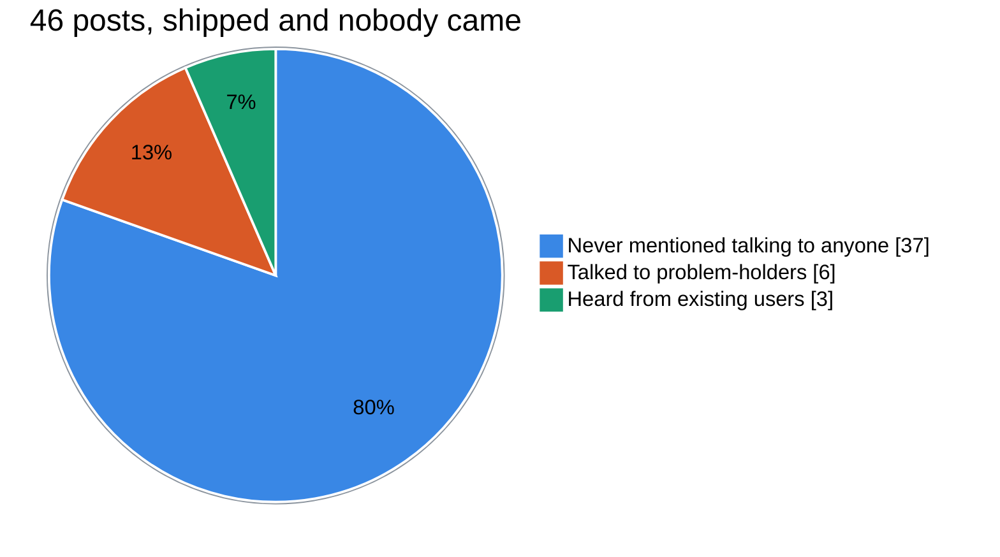

# Harvest brief, 2026-10-16

14 items shortlisted from 288 candidates (144 dropped as already seen, 17 carry a vault verdict on the vendor).

## 1. [vault] Paper-forward cluster log from the EDGAR daily index with a pre-registered 100-signal bar
key: vault:2026-10-16:paper-forward-cluster-log-from-the-edgar-daily-index-with-a-
url: 
meta: {"vault_status": "open", "kind": "idea", "subject": "US insider cluster-buy signal from SEC Form 4 data (paper backtest, Jul 2023 to Oct 2026)", "date": "2026-10-16", "where": "TRITON-CORE/Ventures/Trading/VERDICT-2026-10-16-insider-clusters.md", "has_transcript": false}
query: open
VAULT THREAD, status open: one theme split out of a link Luke sent the vault. Judge the idea on its own: what the mechanism is, how it would be done, what tools it needs. The vault's status and note are context about the vendor and about Luke's time, not a verdict on the idea. Keep it unless the mechanism itself is unlawful or crosses the charter line (fraud services, stolen data, impersonation, explicit deepfakes of real people, unlicensed gambling). Lens is mechanism.

Vault status: open, meaning nobody on the vault side has run it to a verdict.

The vault's note on this theme: Only if Luke wants a live read; nothing scheduled

The vault's verdict on the parent link, which judged the vendor and Luke's time, not this theme: (idea) Can't tell, leaning no. Clusters of 3+ officer or director open-market buys beat random same-size US stocks by about 1.3% per 21 days before costs in the last 24 months, but after a 0.45% UK retail round trip the gap is not distinguishable from zero, and an equal-weight 21-day portfolio lagged SPY with a deeper drawdown.

## 2. [hn] How the Claude Code team does code review
key: hn:50122951
url: https://claude.dev/blog/solving-code-review-at-anthropic/
discussion: https://news.ycombinator.com/item?id=50122951
meta: {"points": 153, "comments": 152, "created": "2026-10-16T19:04:47Z"}
query: claude code

page: How the Claude Code team does code review / claude.dev Blog Engineering How the Claude Code team does code review How do you review code at the volume agents produce it? On the Claude Code team, once we had high coverage and deep reviews, we started optimizing for the minimum amount of human review time that doesn't raise reverts or incidents. AUTHOR Addy Osmani, Morgan Westlee Lunt, and Qing Wang CATEGORY Engineering PUBLISHED Oct 15, 2026 READING TIME 14 min How the Claude Code team does code review TREE └ Rethinking the purpose of code review └ The scarce resource: human time and attention └ The life of a change └ Layer by layer └ How we make the reviewer better └ Where humans stay in the loop └ Sharing context across the team └ "You land it, you own it" └ When we change direction └ How you can adopt this process └ Where this is going ░░░░░░░░░░░░░░░░░░░░░░░░░░░░ 00% 14 MIN READ SHARE X.com LinkedIn Email Copy URL Copy markdown We've said before that Claude writes about 90 percent of Claude Code's own code. So how do we review code at the volume we produce it? Does anyone read code anymore? And if something breaks, who catches it? This post covers the code review flow on the Claude Code team and how it has evolved. From June to September, merged pull requests to Claude Code's codebase more than doubled while the share that had to be reverted fell by more than 40 percent. We didn't remove review. But we did move most of the reading to machines, optimized for human time and attention, and invested heavily in making it fast and easy to undo mistakes. RETHINKING THE PURPOSE OF CODE REVIEW When agents write code, the number of changes goes up, fast. In Anthropic's monorepo, changes landing per day went from about 2,500 in May to more than 30,000 in September this year. Claude Code lives in its own repository, separate from the monorepo, but it's seeing a lot of pressure too. When you are shipping this fast, manual, line-by-line code review is incredibly difficult if n
comment (crooked-v): Well, that explains the Github repo with 5000 issues, maybe about a third of which are random regressions of previous behavior.
comment (jstummbillig): That's a shockingly low number.
comment (mixtureoftakes): 30 thousand changes merged per day? no. like just no. what are we doing? I'm trying to understand

## 3. [github] pro-vi/cc-stretch: Stretchtext replies for Claude Code: short by default, each phrase grows in place when you click it
key: gh:pro-vi/cc-stretch
url: https://github.com/pro-vi/cc-stretch
meta: {"stars": 341, "created": "2026-10-14", "pushed": "2026-10-16", "language": "TypeScript", "topics": []}
query: claude-code created:>{since} stars:>20

# cc-stretch

**Claude writes a lot. Now you can read a little.**

Replies arrive short. Click a linked phrase and it grows right where it stands. Click `«` and it
shrinks back. Claude is told which parts you opened, so it doesn't assume you read the rest.

## Install

In a Claude Code session:

```
/plugin install cc-stretch --marketplace pro-vi/cc-stretch
/tui fullscreen
```

In the terminal, clicks need Claude Code's fullscreen renderer. `/tui fullscreen` switches to it,
restarting and resuming your session. If stretches still show open, see [Limits](#limits). In the
Claude desktop app stretches are links: click one to open it in place, click `«` to close it. No
setting needed.

## What to expect

You read about a sixth of what Claude writes. Across 69 real replies from four of my coding
projects, the version you see before clicking was 17% of the words Claude wrote without the
plugin. It carries about two of every three most important points; the rest is one click away. My
replies run long, so if yours are short you will save less. How this was measured, and how to run
it on your own transcripts: [`bench/`](bench/README.md).

## A silly plugin about a serious idea

In 1967 Ted Nelson described **stretchtext**: text that "stretches, becoming longer, with
replacement phrases, new details and additional clauses popping into place", and shrinks back on
demand, while "the reader remains oriented" (*Hypertext Note 8*). In 1970 he put it like this:
"Gaps appear between phrases; new words and phrases pop into the gaps, an item at a time."

It never caught on. The hard part, as later writers put it, was "how to author the text in the
first place" (Wadge and schraefel, 1999): someone had to write every level by hand.

Language models write every level for free, and they are good at it. So all this plugin does is
plug a 59-year-old idea into a terminal. The idea is Nelson's. Most of the code is Claude's. I
mostly clicked things.

Here is what that looks like. The reply opens with

> A monad is a type that wraps values and lets you chain steps that each return a wrapped value.

and one click on that sentence turns it into this (new words in bold, the way *Dream Machines*
appears to set the words Nelson's own example adds):

> **In programming,** a monad is a **generic** type that wraps values, **and it** lets you chain
> steps that each **take a plain value and** return a wrapped value**, without unwrapping anything
> by hand between the steps.**

The words you already read never move. New ones open up around them, on both sides.

## Three words

- **skim**: a reply with every stretch closed. What you read by default.
- **full**: the same reply with every stretch open. Everything Claude wrote.
- **read**: what you actually read, the skim plus the stretches you opened.

The point of the plugin is the gap between them. Nelson's word for this was levels; ours is
*progressive attention*. Progressive disclosure is the interface deciding what to hide from you.
Here you spend your attention one phrase at a time, and because nothing you have read moves, you
never lose your place.

## What else it does

- **Stretches nest.** A long form can hold more stretches.
- **Streaming stays clean.** While a reply streams, stretches already show as their short forms.

## Limits

- Clicks work in the terminal's fullscreen layout and in the Claude desktop app. Everywhere else every
  stretch shows open, so nothing is hidden: in other apps, and on the terminal's main

## 4. [arxiv] MLExpert: Towards a Generalist Agentic Model for Autonomous Machine Learning Engineering
key: arxiv:2610.22344
url: https://arxiv.org/abs/2610.22344
meta: {"published": "2026-10-15", "authors": ["Shangheng Du", "Jinxin Shi", "Shuaiyu Zhang", "Yiming Wu"], "categories": ["cs.AI", "cs.CL", "cs.LG"]}
query: all:"language model" AND all:agent AND all:tool

Large language models (LLMs) are expanding from assisting scientific research and engineering to autonomously developing and improving AI systems, advancing AI for AI (AI4AI) as a pathway toward recursive self-improvement (RSI). Workflow-driven machine learning engineering (MLE) systems provide a practical path toward this pursuit through complex orchestration that manages long-horizon experimentation, while recent MLE systems adopt model-directed interaction, allowing models to autonomously organize experiments and adapt optimization strategies based on execution feedback. However, feedback from each experiment reflects several preceding decisions, and a long MLE run contains many such costly experiments. Training must therefore select useful supervision from long interaction trajectories and learn from intermediate outcomes. We propose a post-training method for autonomous long-horizon MLE optimization and apply it to train MLExpert, a 35B Mixture-of-Experts agentic model. We design the Kaggle-MLE Factory to construct executable tasks and an interaction harness for model-directed experimentation. Hierarchical agentic SFT transfers general tool-use and coding capabilities to MLE through outcome-guided supervision. Windowed Interaction RL (WIRL) treats the multi-turn decisions between successive experiment results as an execution window and assigns it a shared outcome-based reward. Asynchronous collection and policy correction support policy updates before the trajectory ends. On MLE-Bench Lite, MLExpert improves the average medal rate of the base model from 37.9% to 72.7%, achieving performance comparable to larger frontier models such as Kimi-K3 and GLM-5.3. Further experiments show that MLExpert improves performance on NatureBench Lite, agent scaffold optimization, and algorithm optimization, suggesting that the learned optimization capability generalizes to other tasks.

## 5. [youtube] This Chess AI NEVER Loses: How to Build Your Own Bot
key: yt:5DcaUHhu0KQ
url: https://www.youtube.com/watch?v=5DcaUHhu0KQ
meta: {"channel": "ChessNewLife", "rank": 1, "duration_min": 5}
query: lichess bot python engine

# This Chess AI NEVER Loses: How to Build Your Own Bot
# ChessNewLife
# https://www.youtube.com/watch?v=5DcaUHhu0KQ

[00:00] Yes, the title is real. Today, I'm going to show you how to cheat in chess legally. And before you close this video thinking I'm about to tell you to go to the bathroom every 5 minutes like a certain world championship finalist, no. What I'm about to show you is completely allowed. In fact, the platform encourages it. Here's the idea. Lichess, the biggest free chess platform in the world, has an official bot API. That means you can create a chess account that is literally powered by an engine, connected to Stockfish, and watch it destroy human beings automatically while you sleep. And by the end video, you'll have your own bot running. Let's go.
[00:33] Quick context before we dive in. Stockfish is a free open-source chess engine. It has an Elo rating of around 3600 plus. Magnus Carlsen, the greatest human player of all time, peaks at around 2882. Stockfish doesn't care. Stockfish doesn't feel pressure. Stockfish doesn't blunder in time trouble. Lichess is a free open-source chess platform. No ads, no paywalls, just chess. And unlike chess.com, Lichess has something called the bot API, an official documented feature that lets you register a bot account and have it play real games against real people. This is not a loophole. This is not a
[01:06] gray area. There is literally a section in Lichess's documentation called play as a bot. The only rules are the bot account must be a separate account. You can't play normally on it anymore. You have to be transparent. It shows as bot on the profile. Other than that, go crazy. So, what we're building today is a Lichess bot account powered by Stockfish 18 that plays at superhuman level 24/7 against anyone who dares challenge it. First things first, you need a separate Lichess account for the bot. Do not use your main account. Once you convert an account to a bot, it can't play normal games anymore. It
[01:38] becomes a machine forever. So, go to lichess.org, log out, and create a new account. Name it whatever you want. Something that sounds robotic and menacing works great for the algorithm. A few moments later. Now, still logged in as the bot account, go to lichess.org/account/oauth/token/create. This is where you generate an API token. Basically, a password that lets your script talk to lichess on behalf of this account. In the token creation page, you'll see a bunch of checkboxes. You only need three. Challenge read so the bot can see incoming challenges.
[02:10] Challenge write so it can accept or decline them. Bot play so it can actually make moves. Check those three, give it a description like bot token, and hit submit. Copy that token and save it somewhere safe. It only appears once. If you lose it, you have to generate a new one. Now, open your terminal and run this command replacing the your token here with your actual token. If it responds with okay, true. Congratulates, your account is now officially a bot. Now, we need the actual brain and the brain is Stockfish. If you're on Mac, open terminal and run brew install Stockfish. If you don't have homebrew installed, just Google
[02:44] install homebrew. It takes 30 seconds. On Windows, go to stockfishchess.org and download the binary directly. That's it. Stockfish is now on your machine. One of the strongest chess engines ever written, completely free. The developers have spent decades optimizing this thing and the
[transcript continues in field-notes/staging/5DcaUHhu0KQ.txt]

## 6. [awesome] haabe/mycelium (new in awesome-claude-code)
key: gh:haabe/mycelium
url: https://github.com/haabe/mycelium
meta: {"list": "awesome-claude-code", "stars": 47, "created": "2026-04-07", "language": "Python", "description": "Prevent wasting time building the wrong thing. A plugin that keeps you and your AI coding agent focused, from first idea to market."}
query: awesome-claude-code
SEEN: the vault already judged this vendor (vault: tools and repos). Record the mechanism only if it is new; do not re-judge the vendor.

# Mycelium

[](https://github.com/hesreallyhim/awesome-claude-code)

Mycelium won't make your idea good. It keeps you and your agent honest about whether it is, from first idea to market.

Built on Claude Code, where the gates are structural. The files and skills port to [opencode](docs/integrations/opencode.md), [Codex](docs/integrations/codex.md) and [Cursor](docs/integrations/cursor.md).

**Outcome over output.**

You know how this goes. The idea turns up on a Thursday and it is a good one. The agent is quick and generous and by Sunday there is a working thing on your screen. It runs. You are pleased with it, and you have every right to be.

The building was never the hard part.

The hard part might've happened on Thursday, in about four minutes, mostly in your head. Who this is for. Whether any of them has actually said so. What would have to be true for it to matter to them. Which of those you were betting the weekend on.

Or it might not have happened at all. I like it, so other people will too. That is a real feeling, and from the inside it is almost impossible to tell apart from a reason.

Nobody skips that part because they think it doesn't matter. Something is always in the way, and it is usually something reasonable. On your own it is that asking anyone takes days and the agent is ready now. On a team I have watched it be end of season, a customer on the phone, the c-level with a gut feeling. I have got more than fifteen years of that, and I never met anyone who thought discovery was optional.

You know there are subreddits where people confess exactly this every week? I dropped down the rabbit hole for a count and found a clear structure. I read 46 posts where someone shipped their awesome product to nobody. Most of them never said they asked anybody if they needed what they built. A handful did. Mostly sideways. Like a sales call or a Facebook favor. Some were lucky enough to have existing users they could ask. Whether any of those nine asked before they built, the posts don't say.



Floor, not a rate. Nobody volunteers the thing they skipped. [The full read, all 46 posts](docs/receipts/cases/2026-08-16-l1-population-read.md). If you are in one of those posts right now, [start here](docs/nobody-used-it.md).

What changed is that the agent made skipping it free. It goes from an idea to a pull request faster than any of those reasons ever could, and it never once stops to ask who the thing is for.

## The version where that goes well

Most of what gets thrown away in December was obvious back in August, if anyone had asked. Write the assumption down Thursday. Go find out Friday, while being wrong still costs nothing. The reasoning sits in git next to the code, hunch and all, so later you can tell whether you had a reason back in August or only wanted one. And loops short enough that you and the agent stay pointed at the thing you actually meant to build.

Same weekend. Spent once instead of twice.

## Where Mycelium comes in

It puts the questions where your agent works, and it makes 

## 7. [vault] mistake-becomes-a-rule trade journal
key: vault:2026-10-15:mistake-becomes-a-rule-trade-journal
url: https://www.instagram.com/reel/DeR5ycpITv3/
meta: {"vault_status": "open", "kind": "idea", "subject": "@grandmasterbey prop-challenge trading bot reel", "date": "2026-10-15", "where": "TRITON-CORE/Research/links/2026-10-16-grandmasterbey-prop-bot-reel.md", "has_transcript": false}
query: open
VAULT THREAD, status open: one theme split out of a link Luke sent the vault. Judge the idea on its own: what the mechanism is, how it would be done, what tools it needs. The vault's status and note are context about the vendor and about Luke's time, not a verdict on the idea. Keep it unless the mechanism itself is unlawful or crosses the charter line (fraud services, stolen data, impersonation, explicit deepfakes of real people, unlicensed gambling). Lens is mechanism.

Vault status: open, meaning nobody on the vault side has run it to a verdict.

The vault's note on this theme: one line cause per losing or odd trade in the S1 paper window, rule change or variance

The vault's verdict on the parent link, which judged the vendor and Luke's time, not this theme: (idea) no evidence: 7 trades, +256 dollars on micro Nasdaq; entry rules same as the 8 Oct retest pattern; journal habit worth keeping Write-up: `TRITON-CORE/Research/links/2026-10-16-grandmasterbey-prop-bot-reel.md` Link: https://www.instagram.com/reel/DeR5ycpITv3/

## 8. [hn] Postgres 19 delayed after AI reviewers find more bugs than humans can fix
key: hn:50119991
url: https://www.theregister.com/databases/2026/10/16/postgres-19-delayed-after-ai-reviewers-find-more-bugs-than-humans-can-fix/5303471
discussion: https://news.ycombinator.com/item?id=50119991
meta: {"points": 166, "comments": 63, "created": "2026-10-16T15:55:40Z"}
query: car data

comment (ferguess_k): I guess with LLM as the reviewer, it is going to take a lot longer to be Zero Defect, unless they use LLM as the coder, too.
comment (Tanjreeve): This is the happy path for LLM assisted coding. Obviously consumes less tokens being more constrained and focused so it's not what gets the most marketing but having the second loop of code reviews seems worth investment even if the coding loop is entirely manual or you're in full LLM autopilot mode
comment (F7F7F7): Training data is filled with shortcuts, conveniences, bugs, hacks, hacks that fix other hacks, hot fixes, patches, mappings that map the hack to hack to a better solution and all types of other surprises. That's the cost of trying to scale so quickly. You dont filter out the crap. A nice side effect is that the best way to fix it is more AI. It's a endless money loop.

## 9. [github] Leonxlnx/earshot: Ears for coding agents: let AI hear, review and make sound. CPU-only, open source.
key: gh:leonxlnx/earshot
url: https://github.com/Leonxlnx/earshot
meta: {"stars": 302, "created": "2026-10-15", "pushed": "2026-10-16", "language": "Python", "topics": ["ai-agents", "audio", "claude-code", "mcp", "sound-design"]}
query: claude-code created:>{since} stars:>20

# earshot

**Ears for coding agents.**

 
[**Watch the 22 s launch film**](https://github.com/Leonxlnx/earshot/releases/tag/v0.1.0) - every sound in it was made
in code by `earshot forge`; no recordings, no music track.

AI coding agents can now write the code that renders a film, a product demo or a game. They still cannot hear what
they made. They cannot tell a premium key press from a cheap one, notice that a hit lands 80 ms after the cut, or
hear that the music swells in the wrong place.

earshot turns sound into evidence an agent can reason about: what a file sounds like in words, how well it fits a
description, the best moment inside a long recording, whether it is a real recording or code-synthesized, a
second-by-second listening transcript of a whole film, an annotated picture of it, and a scorecard against
professional launch films. It runs locally on CPU, as a CLI, a Python API and an MCP server.

With ears, an agent can also **make its own sounds in code** and improve them by listening (`earshot forge`), and
**translate a recording into code** it can vary (`earshot fit`). Both below.

```
$ earshot describe enter.ogg
  0.56 s short transient (attack 3 ms, decays in 190 ms). Sounds most like: a single mechanical keyboard key press
  (z +5.4), a soft key release click (z +3.6) ... [clear reading]. peak -0.1 dBFS, brightness 1.5 kHz ...

$ earshot match key.ogg "a deep thocky mechanical keyboard press" --alts "a clicky blue switch keyboard" "a mouse click"
  -> strong (z +3.7; would rank #2 among 322 vocabulary descriptions) ...

$ earshot find keys.ogg "a single mechanical key press" --top 4
  0:03.94-0:04.19 (0.24 s stroke, z +4.1 strong); 0:10.60-0:10.86 ...

$ earshot critique film.mp4
  VERDICT: close - 21 of 23 scored metrics in range ... FIX FIRST: 1. [major] nothing reaches body level until 0:01.01 ...
```

## What it does

| command | what an agent gets |
|---|---|
| `describe FILE` | what it sounds like: calibrated tags (z) with the closest alternative readings, AudioSet labels, measurements |
| `match FILE QUERY [--alts ...]` | how well a description fits: cosine, z among the vocabulary, a verdict (strong / plausible / weak / no match) with held-out evidence |
| `rank QUERY PATHS...` | many candidate files sorted by a description (pick the best download) |
| `find FILE QUERY` | the best moments inside a long recording, as sample trims (start / end seconds) |
| `compare FILE --refs DIR` / `ab A B` | nearest reference recordings and typicality; A/B two sounds or two trims, the differences in words |
| `realness FILE...` | real recording / pro-produced vs code-synthesized, with evidence and per-window scores |
| `timeline FILE [--video V] [--cues C]` | the listening transcript: events (time, level, tag), sections, loudness, beat grid, sync of sound to picture cuts and cue frames |
| `sheet FILE -o out.png` | an annotated PNG (video frames, sections, labelled events, spectrogram, waveform, loudness, sync markers) for agents that read images |
| `critique FILE [--video V]` | a launch-video scorecard against a profile of 7 professional launch films, with timestamped fixes |
| `profile REFS... -o p.json` | build your own reference profile from films you admire |
| `measure FILE` | objective measurements only (no models): LUFS, true peak, LRA, envelope, spectrum, tempo / key |
| `forge RECIPE --refset CAT` | make a sound in code and improve it by listening (see below) |
| `fit FILE -o recipe.py` | translate a recording into a

## 10. [arxiv] Learning to Steer LLM Agents and Multi-Agent Systems
key: arxiv:2610.22316
url: https://arxiv.org/abs/2610.22316
meta: {"published": "2026-10-15", "authors": ["Leyang Shen", "Yaxin Gong", "Yang Zhang", "Chenxiao Fan"], "categories": ["cs.LG", "cs.AI", "cs.MA"]}
query: all:"language model" AND all:agent AND all:tool

Large language model (LLM)-based agents and multi-agent systems increasingly tackle complex tasks through long-horizon tool use and inter-agent collaboration. However, these systems are prone to deviating from the overall goal as execution unfolds, which wastes execution resources and leads to undesired outcomes, a failure termed goal drift. In this work, we propose a steering agent that supervises execution on the fly and steers the system back on track when drift occurs. The steering agent observes the execution context, deciding when to intervene with a low-cost fast path and how to intervene with a high-cost slow path. To unlock its steering intelligence, the ability to assess goal drift and generate effective interventions, we jointly train the two paths with reinforcement learning, combining a pairwise ranking objective with group-relative policy optimization (GRPO). Experiments on information-seeking search tasks show that the steering agent provides effective supervision for both single-agent and multi-agent systems, improving their performance and efficiency. The learned steering intelligence generalizes to out-of-domain tasks, transfers to unseen executors, and supports controllable intervention frequency without retraining.

## 11. [youtube] From the Classroom to the Workshop - UK MOT Tester Training
key: yt:DfF8mJM25QU
url: https://www.youtube.com/watch?v=DfF8mJM25QU
meta: {"channel": "MOT Expert", "rank": 1}
query: MOT data analysis uk


[body unavailable: TranscriptsDisabled]

## 12. [awesome] i18next/i18next-cli (new in awesome-claude-code)
key: gh:i18next/i18next-cli
url: https://github.com/i18next/i18next-cli
meta: {"list": "awesome-claude-code", "stars": 244, "created": "2025-09-24", "language": "TypeScript", "description": "A unified, high-performance i18next CLI."}
query: awesome-claude-code
SEEN: the vault already judged this vendor (vault: tools and repos). Record the mechanism only if it is new; do not re-judge the vendor.

# i18next-cli 🚀

A unified, high-performance i18next CLI toolchain, powered by SWC.

[](https://github.com/i18next/i18next-cli/actions?query=workflow%3Anode)
[](https://www.npmjs.com/package/i18next-cli)

---

> By default, `i18next-cli` only extracts translation keys from JavaScript and TypeScript files (`.js`, `.jsx`, `.ts`, `.tsx`).
> To extract from other file types (such as `.pug`, `.vue`, `.svelte`, etc.), you must use or create a plugin. Specifying additional file extensions in the `extract.input` config is not sufficient on its own—plugins are required for non-JS/TS formats. See the [Plugin System](#plugin-system) section for details and examples.

`i18next-cli` is a complete reimagining of the static analysis toolchain for the i18next ecosystem. It consolidates key extraction, type safety generation, locale syncing, linting, and cloud integrations into a single, cohesive, and blazing-fast CLI.

> ### 🚀 Try it Now - Zero Config!
> You can get an instant analysis of your existing i18next project **without any configuration**. Just run this command in your repository's root directory:
>
> ```bash
> npx i18next-cli status
> ```
> Or find hardcoded strings:
>
> ```bash
> npx i18next-cli lint
> ```

## Advice:

If you're looking for a managed backend to pair with `i18next-cli`, take a look at [Locize](https://www.locize.com?utm_source=i18next_cli_readme&utm_medium=github&utm_campaign=readme) — `i18next-cli` already ships with `locize-download`, `locize-sync`, and `locize-migrate` commands. Built by the same team behind i18next, with CDN delivery, AI translation, review workflow, and no redeploys for copy changes.

## Why i18next-cli?

`i18next-cli` is built from the ground up to meet the demands of modern web development.

- **🚀 Performance:** By leveraging a native Rust-based parser (SWC), it delivers orders-of-magnitude faster performance than JavaScript-based parsers.
- **🧠 Intelligence:** A stateful, scope-aware analyzer correctly understands complex patterns like `useTranslation('ns1', { keyPrefix: '...' })`, `getFixedT`, and aliased `t` functions, minimizing the need for manual workarounds.
- **✅ Unified Workflow:** One tool, one configuration file, one integrated workflow. It replaces various syncing scripts.
- **🔌 Extensibility:** A modern plugin architecture allows the tool to adapt to any framework or custom workflow.
- **🧑‍💻 Developer Experience:** A fully-typed configuration file, live `--watch` modes, CLI output, and a migration from legacy tools.

## Features

- **Key Extraction**: Extraction means automatically finding and collecting all translation keys used in your source code (JavaScript/TypeScript, etc.) by analyzing the code's structure (AST). This ensures every string that needs translation is identified and included in your translation files, reducing manual work and preventing missing keys.
- **Type Safety**: Generate TypeScript definitions for full autocomplete and type safety.
- **Locale Synchronization**: Keep all language files in sync with your primary language.
- **Accurate Code Linting**: Detect hardcoded strings with high precision and configurable rules.
- **Translation Status**: Get a high-level overview or a detailed, key-by-key report of your project's translation completeness.
- **Plugin System**: Extensible architecture for custom extraction patterns and file types (e.g., HTML, Handlebars).
- **Legacy Migration**: Automatic migration from `i18next-parser` configurations.
- **Cloud Integration**: S

## 13. [vault] longer test of the retest rules
key: vault:2026-10-15:longer-test-of-the-retest-rules
url: https://www.instagram.com/reel/DeR5ycpITv3/
meta: {"vault_status": "open", "kind": "idea", "subject": "@grandmasterbey prop-challenge trading bot reel", "date": "2026-10-15", "where": "TRITON-CORE/Research/links/2026-10-16-grandmasterbey-prop-bot-reel.md", "has_transcript": false}
query: open
VAULT THREAD, status open: one theme split out of a link Luke sent the vault. Judge the idea on its own: what the mechanism is, how it would be done, what tools it needs. The vault's status and note are context about the vendor and about Luke's time, not a verdict on the idea. Keep it unless the mechanism itself is unlawful or crosses the charter line (fraud services, stolen data, impersonation, explicit deepfakes of real people, unlicensed gambling). Lens is mechanism.

Vault status: open, meaning nobody on the vault side has run it to a verdict.

The vault's note on this theme: 10-week NQ 15m backtest gave +1878 on 1 MNQ at 2R, beat 95 pct of random runs; needs 2 years of 1h bars before anyone says more

The vault's verdict on the parent link, which judged the vendor and Luke's time, not this theme: (idea) no evidence: 7 trades, +256 dollars on micro Nasdaq; entry rules same as the 8 Oct retest pattern; journal habit worth keeping Write-up: `TRITON-CORE/Research/links/2026-10-16-grandmasterbey-prop-bot-reel.md` Link: https://www.instagram.com/reel/DeR5ycpITv3/

## 14. [hn] Anthropic Console overcharged my card 100x due to internationalization input bug
key: hn:50121562
url: https://news.ycombinator.com/item?id=50121562
discussion: https://news.ycombinator.com/item?id=50121562
meta: {"points": 82, "comments": 30, "created": "2026-10-16T17:31:42Z"}
query: car data

I am a LegalTech Attorney leading a developer team from Costa Rica. While trying to load credits onto my Anthropic API account (claude.com), I experienced a critical internationalization (i18n) and UX failure that has placed an unfair financial burden on me due to a severe oversight in their payment pipeline. The platform prompted me for a payment. Since I am in a Spanish-speaking region where localized systems and keyboards handle dots and commas differently, I typed 5.04. Anthropic’s input system completely failed to sanitize or validate the data. Instead of throwing a formatting error or converting it properly, it silently stripped the decimal internally and instantly charged my credit card $504.00 USD instead of $5.04 USD. To make matters worse, there was no confirmation modal or review screen summarizing the final amount before processing the transaction. It was a single-click, instantaneous overcharge. Anticipating the Obvious Skepticism: Before anyone suggests "you should have checked your regional settings" or "just wait for the chargeback": 1. Users are not the QA team: In financial software, a system is never supposed to guess or automatically manipulate a numerical input without explicit validation. If an input is ambiguous due to locale differences, the application must reject it or ask for clarification, not execute a 100x overcharge. 2. Scale of the vulnerability: This time it was $504.00, which is an unfair and frustrating burden for independent developers. But
comment (rsorto): UPDATE: I just checked my bank statement and it’s even worse than I thought. Because the system processed the incorrect $504.00 base amount, it automatically calculated local VAT (taxes) on top of it, adding an extra $65.52. The absolute total taken from my card by this single-click bug is $569.52. Here is the proof of the bank statement pending charge: https://ibb.co/tMVkf0nx
comment (UnlockedSecrets): did this post really need to be written by AI?
comment (merb): What did you want to accomplish with 5.04?? In Spanish or other European countries 5,04 would’ve been correct? So 5.04 would either be invalid or 504 like Claude did.
