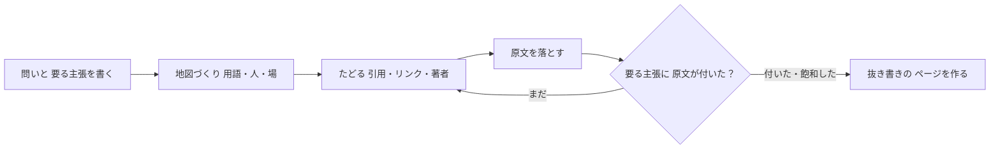

# Harvest brief, 2026-10-19

14 items shortlisted from 346 candidates (179 dropped as already seen, 12 carry a vault verdict on the vendor).

## 1. [vault] daily news roundup with talking head over screenshots
key: vault:2026-10-19:daily-news-roundup-with-talking-head-over-screenshots
url: https://www.instagram.com/reel/DeqInQdRkfU/
meta: {"vault_status": "open", "kind": "idea", "subject": "cryptogorillayt: daily memecoin roundup reel", "date": "2026-10-19", "where": "TRITON-CORE/Research/links/2026-10-19-cryptogorilla-memecoin-daily-ai-persona-tokens.md", "has_transcript": false}
query: open
VAULT THREAD, status open: one theme split out of a link Luke sent the vault. Judge the idea on its own: what the mechanism is, how it would be done, what tools it needs. The vault's status and note are context about the vendor and about Luke's time, not a verdict on the idea. Keep it unless the mechanism itself is unlawful or crosses the charter line (fraud services, stolen data, impersonation, explicit deepfakes of real people, unlicensed gambling). Lens is mechanism.

Vault status: open, meaning nobody on the vault side has run it to a verdict.

The vault's note on this theme: repeatable format for a character or theme page

The vault's verdict on the parent link, which judged the vendor and Luke's time, not this theme: (idea) Cheap daily talking-head-over-screenshots news format with a paid sponsor slot; carries the AI-persona-token pattern as intel Write-up: `TRITON-CORE/Research/links/2026-10-19-cryptogorilla-memecoin-daily-ai-persona-tokens.md` Link: https://www.instagram.com/reel/DeqInQdRkfU/

## 2. [hn] Ask HN: How to deal with shipping AI-written code you don't understand?
key: hn:50151036
url: https://news.ycombinator.com/item?id=50151036
discussion: https://news.ycombinator.com/item?id=50151036
meta: {"points": 177, "comments": 289, "created": "2026-10-19T11:24:34Z"}
query: car data

I saw this LinkedIn post from a Meta engineer and it resonated with me: https://www.linkedin.com/posts/ali-hamie_im-an-engineer-at-m... > I'm an engineer at Meta and I never felt this uncomfortable doing my job. I'm writing code these days and it all feels like a black box. This new standard of shipping with AI is moving so fast that if we're going to spend our time checking each line of code, it's going to take forever. That means you can end up with systems you've built where you don't truly understand how all the code works. You understand the high level, but not every detail. And maybe this is becoming the new standard. It goes against every instinct of being a software engineer. I'm used to understanding what I'm building. Now I'm trying to figure out how much I need to understand before I'm comfortable moving forward. Are other engineers feeling this too? How are you handling this?
comment (spacedcowboy): I’m slowly coming around to the idea that if it works, I’m good with that. I never used to personally check all my colleagues work, either, I just trusted that they’d done a good job. That’s not to say I blindly trust an LLM - my project is an autovectorising compiler. I have it write a bazillion tests, and I have real, non-trivial programs that it compiled. I have it run a ‘gate’ before releases that takes literally hours on 5 different architectures. To say this code is tested is … masterful understatement. I think what helps is a long planning session, going into details, working out corner
comment (pinscope_dev): I had same problem, but after a while I just accepted that is inevitable
comment (edwin0): The part that makes me uneasy is when the AI writes both the code and the tests. They might agree with each other and still miss the same thing. How are people here checking for that without doing the whole job twice?

## 3. [github] Gathin23/cleanyourtv: Debloat any Android or Google TV over Wi-Fi and get an Apple TV-style home.
key: gh:gathin23/cleanyourtv
url: https://github.com/Gathin23/cleanyourtv
meta: {"stars": 4975, "created": "2026-10-17", "pushed": "2026-10-19", "language": "Java", "topics": ["adb", "adblock", "android-tv", "android-tv-launcher", "apple-tv", "bloatware-removal", "claude-code", "debloat"]}
query: claude-code created:>{since} stars:>20

cleanyour.tv  ·
   The prompt  ·
   54 TV lists  ·
   12 built on it  ·
   The tweet 
 

 
     
     
     
     
     
     
 

Strip the bloatware from any Android TV or Google TV over Wi-Fi, and replace the ad-filled home
screen with a clean launcher that looks like an Apple TV. **No root, no cable, nothing uninstalled,
and a one-line restore if you change your mind.**

 54 TVs with tested lists &nbsp;·&nbsp; 23 brands &nbsp;·&nbsp; 12 languages &nbsp;·&nbsp; 280 KB launcher 

> Vibe coded my parents' TV this afternoon! It was showing a sponsored ad before you could even get
> to Netflix. Gave Claude Code the model number, it found the TV on wifi, removed 25 Xiaomi packages
> and wrote a new launcher. Looks like an Apple TV now lol.
>
> [@gathint, 17 October 2026](https://x.com/gathint/status/2111379569030939102). The replies are where
> most of the TV lists here came from. The repo was called tv-vibehack until the 19th; old links work.

## How it works

Android TVs have the same debug bridge as Android phones. Switch on USB debugging in the TV's
developer options, allow your computer once, and the rest is standard Android tooling:

1. **Back up** the list of installed packages and settings.
2. **Disable** the manufacturer's telemetry, ad services, content rows and preloaded junk with
   `pm disable-user`. Nothing is uninstalled, so a restore script can undo every step.
3. **Install** a small native launcher and make it the default home screen.

The bloat differs by brand, so the prompt has your coding assistant discover it on your TV and ask
before touching anything you might use.

## Quick start

You need a computer on the same Wi-Fi as the TV and a coding assistant with shell access
(Claude Code or similar).

| | |
|---|---|
| **1. On the TV** | Settings → Device Preferences → About → press OK on **Build** seven times → back → Developer options → **USB debugging** on. If you see a Network or ADB debugging toggle, turn that on too. Keep the TV on. |
| **2. On your computer** | Paste [`PROMPT.md`](PROMPT.md) into your assistant and fill in your TV model. |
| **3. Follow along** | Accept "Allow USB debugging?" on the TV, then answer the checklist: which apps you use, which four go in the dock, whether to keep the voice assistant, Chromecast and updates. |

The assistant backs up, debloats, builds and installs the launcher, and checks each step with
screenshots pulled from the TV. With this repo as context it takes about fifteen minutes.

## What you get

- **A pitch-black home** with a dock of your four favourite apps in a rounded band, where Apple TV puts it.
- **A top shelf** naming the focused app in large type, with an ambient glow in a colour taken from its artwork.
- **The rest of your apps in a grid** that slides up when you press Down.
- **One floating glass highlight** that springs from tile to tile. The focused tile lifts and shows its name.
- **Three frosted buttons**: Inputs (HDMI ports, AV, Live TV), Wi-Fi or Ethernet with the network name, Settings.
- **A greeting, a thin clock and the date** in [Outfit](https://fonts.google.com/specimen/Outfit), and a matching Clock screensaver.
- **Themes** that change colours, wallpaper, dock and columns without a rebuild, and **module cards** that let other apps plug a tile in, only with your say-so.

And a TV that stops working against you: no sponsored rows, no "Discover" nags, no analytics
phoning home, no apps you never asked for.

| | |
|---|---|
|  |  |
| *Top shelf and ambie

## 4. [arxiv] From Trajectories to Differentiated Skills: Cognitive Differentiation for Self-Improving Agents
key: arxiv:2610.23599
url: https://arxiv.org/abs/2610.23599
meta: {"published": "2026-10-16", "authors": ["Yewei Zhao", "Derong Xu", "Wei Chen", "Yin Xu"], "categories": ["cs.AI"]}
query: all:"language model" AND all:agent AND all:tool

Large language model (LLM) agents tackle complex tasks through reasoning and interaction with external environments. Agent skills provide persistent, transferable capabilities that guide task planning, inform contextual decisions, support tool use, and enable executable procedures. Yet existing skill-evolution methods largely organize knowledge around skill artifacts, overlooking the functional heterogeneity within individual skills and its implications for knowledge maintenance and use. Inspired by cognitive science, we propose Cognitive Differentiation in Skill Evolution (CDSE), which evolves a unified skill through four functionally distinct yet coordinated components: Meta, Experience, Tool, and Script. CDSE extracts evidence-grounded semantic gradients from successful and failed trajectories, consolidates them by functional role, and applies component-specific updates and validation with cross-component coordination and adaptive invocation. An analysis of 500 top-ranked skill packages shows that 96.8% contain knowledge spanning at least two functional roles. Across six benchmarks, three agent models, and two execution harnesses, CDSE achieves the highest scores in all 36 settings, improving over the Base agent by 7.6 percentage points and the strongest competing method in each setting by 2.6 points on average. Ablation studies further support the importance of functional differentiation and adaptive invocation.

## 5. [youtube] Lesson 5b: Poisson regression
key: yt:otMo6tN3Vjo
url: https://www.youtube.com/watch?v=otMo6tN3Vjo
meta: {"channel": "David Sumpter", "rank": 3}
query: dixon coles model python


[body unavailable: IpBlocked]

## 6. [awesome] rezored/cubicle-crew (new in awesome-claude-code)
key: gh:rezored/cubicle-crew
url: https://github.com/rezored/cubicle-crew
meta: {"list": "awesome-claude-code", "stars": 32, "created": "2026-10-09", "language": "JavaScript", "description": "Your Claude Code agents, living in a tiny pixel-art office. Desktop widget + browser app, with tokens, a shop and a lounge."}
query: awesome-claude-code
SEEN: the vault already judged this vendor (vault: tools and repos). Record the mechanism only if it is new; do not re-judge the vendor.

### Your Claude Code agents, living in a tiny pixel-art office.

Every Claude Code session becomes a coworker at a desk – and so does every **Codex**, **Gemini CLI** and **OpenCode** session. **Copilot CLI, Cursor or any script** can walk in too through a small local API ([docs/api.md](docs/api.md)). Sub-agents walk in through the door, pick up the task
and sit down with their team. When someone needs you, the whole room lets you know.

[**▶ Watch the trailer**](docs/media/trailer.mp4) · [**⬇ Download for Windows**](https://github.com/rezored/cubicle-crew/releases/latest) · [Quick start](#quick-start) · [Desktop app](#desktop-widget-windows) · [How it works](#how-it-works)

   

 

---

## Why

Claude Code is happiest when it runs a few sessions at once and hands work to sub-agents. That gets hard to follow
from a stack of terminal tabs: who is still busy, who is stuck on a question, who quietly finished ten minutes ago?

Cubicle Crew reads the session logs Claude Code already writes to `~/.claude/projects` and turns them into a live
scene you can leave open on a second monitor, or pin in the corner of your screen as a widget.

- **One look tells you the state of everything.** Each agent's shirt, monitor glow and name tag take the colour of what it is doing.
- **Delegation you can actually see.** Orchestrators walk over and hand paper to their sub-agents. Dotted lines on the floor show who works for whom.
- **You never miss a question.** An agent waiting on you (an `AskUserQuestion`, or an "Allow Bash?" permission prompt) waves, its tag flashes red with "Allow Bash?", a little chime plays if you're looking at another window, and the desktop app sends a Windows notification.
- **Nothing to set up.** No API keys and no hooks to install. It runs offline and only reads local files.

 
   
   
 

## Features

| | |
|---|---|
| 🧑‍💻 **Teams** | Two lead desks with a ★ nameplate share one rug, with three desks for sub-agents below. Any sub-agent takes any free desk; the ones without a desk work on a laptop on the sofa until one frees up. Each team has its own mug colour, and lines connect every lead to its sub-agents. A third session works from the lounge until a lead desk is free. |
| 🔌 **Any agent, one endpoint** | `POST http://127.0.0.1:4317/api/event` (local only) brings anything into the office: ready-made hook configs for **GitHub Copilot CLI** and **Cursor**, any agent with Claude-Code-style hooks, or a script with `curl` / `npx cubicle-crew event tool_start --agent build --tool Bash --detail "npm test"`. They get a desk, a bubble with the current tool, turn red when they wait for you and walk out when they end. See [docs/api.md](docs/api.md). |
| 📄 **Context on the desk** | A stack of paper on every desk grows with the agent's context window, gets a yellow and then a red sticker as it fills up, and flies off the desk when the conversation is compacted. The card shows the exact numbers. Works for Claude Code, Codex and OpenCode. |
| ✅ **Allow / Deny from the office** *(optional)* | Turn on **Answer permission prompts here** in the `?` panel and Claude Code's "Allow …?" questions show up as a bar at the bottom of the office with **Allow** and **Deny** buttons (keys `Y` / `N`; in the desktop app also `Ctrl+Alt+Y` / `Ctrl+Alt+N` from any window). It adds one hook to `~/.claude/settings.json` (a backup is kept) and removes it when you turn it off. The terminal keeps working: if you don't answer in the office within 45 s, or you answer in the

## 7. [vault] offer builder plus 7-day first-client sprint
key: vault:2026-10-19:offer-builder-plus-7-day-first-client-sprint
url: https://www.skool.com/fitscaling-business-school-9423
meta: {"vault_status": "open", "kind": "service", "subject": "Skool: Fitscaling Business School", "date": "2026-10-19", "where": "TRITON-CORE/Research/links/2026-10-19-skool-fitscaling-business-school.md", "has_transcript": false}
query: open
VAULT THREAD, status open: one theme split out of a link Luke sent the vault. Judge the idea on its own: what the mechanism is, how it would be done, what tools it needs. The vault's status and note are context about the vendor and about Luke's time, not a verdict on the idea. Keep it unless the mechanism itself is unlawful or crosses the charter line (fraud services, stolen data, impersonation, explicit deepfakes of real people, unlicensed gambling). Lens is mechanism.

Vault status: open, meaning nobody on the vault side has run it to a verdict.

The vault's note on this theme: the high-ticket offer an AI fitness coach would sell

The vault's verdict on the parent link, which judged the vendor and Luke's time, not this theme: (service) Small free group selling the first-high-ticket-client sprint for coaches; useful template and script source for the AI fitness coach, claims unverified Write-up: `TRITON-CORE/Research/links/2026-10-19-skool-fitscaling-business-school.md` Link: https://www.skool.com/fitscaling-business-school-9423

## 8. [hn] Tmux and Claude Code: Sessions, Send-Keys, and the Ceiling
key: hn:50148855
url: https://crystl.dev/guides/tmux-for-ai-agents/
discussion: https://news.ycombinator.com/item?id=50148855
meta: {"points": 145, "comments": 110, "created": "2026-10-19T05:55:31Z"}
query: claude code

comment (thomas_witt): I really liked Tmux and Zellij for the time being, but Herdr does it all so much better out of the box when it comes to agentic coding. I haven't found something I can do with tmux/zellij but can't do with herdr.
comment (littlecranky67): Been using tmux session to hand over to claude for a while. Paranoid me uses the macbooks secure enclave with fingerprint for the ssh key so claude can't ssh into my remote boxes by himself. I then open named tmux sessions, perform the ssh login via fingerprint, and then tell claude that he is free to take over that session with a given name.
comment (leizzo): It's great to manage subagents using the Claude team mode and tmux integration.

## 9. [github] alchaincyf/huashu-motion: 让你的agent一键直出商业级产品宣传片：会作曲，能指着画面改。Commercial-grade launch films by your coding agent — point at the frame to change it.
key: gh:alchaincyf/huashu-motion
url: https://github.com/alchaincyf/huashu-motion
meta: {"stars": 901, "created": "2026-10-18", "pushed": "2026-10-19", "language": "JavaScript", "topics": ["agent-skills", "animation", "claude-code", "codex", "gsap", "launch-video", "motion-graphics", "skills"]}
query: claude-code created:>{since} stars:>20

**简体中文** | [English](README.en.md)

 

# huashu-motion

> *「一键直出商业级产品宣传片。」*

[](LICENSE)
[](https://agentskills.io)
[](#安装)

**让你的agent做动画、作曲，指着画面改。**

跟Claude Code、Codex这些agent说一句「给我的产品做个30秒的发布片」， 
它会先读你的产品，给你三个方向挑，写出整支片子，自己写谱配乐， 
然后在浏览器里打开一个编辑器等你。哪里不满意，在画面上点一下，写下要改什么，它就只改那一处。

```sh
npx skills add alchaincyf/huashu-motion
```

[看效果](#看效果) · [安装](#安装) · [能做什么](#能做什么) · [怎么做到的](#怎么做到的) · [背后的故事](#背后的故事)

 

---

## 看效果

这篇README里的每一段动画都是huashu-motion做的。上面那段取自它给自己做的53秒发布片，👉 [下载完整发布片（MP4，带声音）](https://github.com/alchaincyf/huashu-motion/releases/latest)，下面Grok Bot、huashu-design、DeepSeek这几支的完整版也在同一个页面。

### 指着画面改

 

按C，在画面上点一下，写下要改什么。评论发过去的时候带着时间点、场景、点中的元素和它在源码里的位置，agent先把那一帧和你点的那一小块截图放大看一眼，再只改那一处，改完回一句人话，预览停在原来的位置刷新。每一版都留着，⌘Z随时撤回；标题、数字、颜色、停留时长这些会变成编辑器右边的输入框，自己改，不用等agent。

（这段里的编辑器和终端是照真实界面重建的，代码细节是示意；评论是真实提过的意见。）

### 先写谱，再拍片

 

做发布片用的是作曲家模式：agent按节奏单先写一份谱（ABC记谱法，纯文本的乐谱），谱里的标记对齐每个场景，再由三角钢琴、弦乐和鼓组的采样演奏出来（真乐器采样要先跑一次`om samples build`，不跑就用合成音色）；画面上每个东西落地的那一帧，再配一个音效。配乐全部在本机现场生成，不调用任何收费接口。

### 一天，二十支

 

16个镜头，来自同一天做的七支片子，按拍子切。

 

Grok Bot（粉丝自制，非官方）· 30秒：傍晚交代任务，夜里几个agent各干各的，早上7点手机上收到汇报。这段是汇报一张张送往Chief of Staff的那几拍。

  
   huashu-design 3.0 · 一句提示词钉住不动，背后的风格按拍子换 
   小猫补光灯Pro · 八种补光色，一拍换一种 
  

### 不依赖Opus：DeepSeek V4.1 Flash也能做

 

这支22秒的动效片，是把Claude Code背后的模型换成DeepSeek V4.1 Flash（1017版）做的。中间我给了三轮意见（比如加上DeepSeek的鲸鱼logo、删掉几个镜头），带配乐和音效，前后不到半小时，按当时的价格花了1块9毛5（缓存命中率99.4%）。统一的配色、贯穿全片的那颗圆点、卡在124BPM上的配乐，是skill带出来的，我一句都没提过。方法写进了skill，便宜的模型也能拍出像样的片子。

---

## 安装

### 方式一：跟你的agent说（推荐）

```
帮我安装huashu-motion这个skill（github.com/alchaincyf/huashu-motion），装好后跑一遍demo
```

### 方式二：一行命令

```sh
npx skills add alchaincyf/huashu-motion
```

[skills](https://github.com/vercel-labs/skills)会认出你在用的agent，把skill放进对应目录；要指定的话加`-a claude-code`、`-a codex`等参数。

Claude Code、Codex、WorkBuddy、Grok Bot、Muse、Dots等产品都能跑；它遵循[Agent Skills](https://agentskills.io)协议，支持skill的agent都能装。

### 方式三：克隆整个仓库

 
 展开查看 

```sh
git clone https://github.com/alchaincyf/huashu-motion.git
ln -s "$PWD/huashu-motion/skills/huashu-motion" ~/.claude/skills/huashu-motion   # Codex换成~/.codex/skills/
```

skill里的`bin/om`会直接调用仓库里的命令行工具，改仓库就是改skill，本机只有一份。

 

### 需要什么

- Node 22以上。
- Chrome（或Chromium、Edge）：截帧、检查、导出都用你电脑上已经装好的浏览器，不额外下载渲染器。
- FFmpeg：导出视频、合成配乐要用。
- 真乐器音色（可选）：想要三角钢琴、弦乐、鼓组，让agent跑一次`om samples build`，下载约55MB的免费采样（CC0和CC-BY授权）；不跑就用合成音色。
- 口播（可选）：macOS的系统音色不用装；想用Kokoro念中文稿，第一次用时会给出一行安装命令（要uv和Python 3.12，模型约325MB）；逐字对齐要装whisper-cli（`brew install whisper-cpp`）。

缺什么跑`om doctor`就知道，这些都可以直接让agent帮你装。目前只在macOS上实测过。Codex的沙箱会拦本地预览和浏览器，遇到时手动批准一下。

---

## 能做什么

装好以后，直接跟agent说：

| 你说 | 它做 |
|---|---|
| 「用huashu-motion给我的产品做一支30秒的发布片，官网是xxx.com」 | 先读产品，出三个方向的关键帧给你挑，写节奏单，再写片、作曲配乐，打开编辑器等你 |
| 「把data/funnel.csv做成30秒解说，讲清楚为什么注册率翻倍了」 | 按数据讲故事：先轴、后数据、只标一件事，数字变成可以直接改的输入框 |
| 「做一支发布片，要口播，用我自己的录音：voice.m4a」 | 逐字对齐，画面落在说到的那个词上，自动出字幕，配乐在说话时让位 |
| 「这条口播视频加个包装」 | 名字条、数字卡、关键词花字、章节卡，导出带透明通道的叠层，直接拖进剪映或Premiere |
| 「改成竖屏」 | 复制一份1080×1920的版本，重新排版的活儿进收件箱，接着改 |
| 「导出GIF」「要透明底」「做成网页分享」 | MP4、MOV（透明）、WebM、GIF；或者导出一个带播放器和源码的分享页 |

开工前，它会先读你以前的偏好和过去片子留下的经验；每支片子做完，再把你这次说过的话、在编辑器里提的评论收一遍，值得留下的记下来。你的偏好只存在你自己电脑上。

---

## 怎么做到的

### 一支片子就是一个`index.html`

画面用代码写，GSAP、Canvas、Three.js、SVG，浏览器能画的都能用；不调用视频生成模型，每一帧只由代码和时间决定。没有私有格式，片子就是一个网页，带走就能用。

```
你的agent ──写──▶ my-film/index.html ◀──盯着── om studio（浏览器里的编辑器）
    ▲                                              │
    └── om inbox --wait ◀── .om/inbox.jsonl ◀── 你在画面上点一下、写一句
```

### 导演规则，不是模板

skill最大的一块是导演方法：先读产品、找出它的气质，再选片子的结构和运动语言。这些规则来自实测，不是拍脑袋：

- 拿21支真实的发布片（Apple、Nothing、GoPro、Googl

## 10. [arxiv] SkillBrowser: Selective Skill Exposure for Scalable Skill-Using Agents
key: arxiv:2610.23554
url: https://arxiv.org/abs/2610.23554
meta: {"published": "2026-10-16", "authors": ["Jin Ye", "Yifan Jiang", "Lan-zhe Guo"], "categories": ["cs.AI"]}
query: all:"language model" AND all:agent AND all:tool

Large language model agents increasingly rely on skills to extend their capabilities in complex tasks. However, scalable skill use requires Selective Skill Exposure (SSE): providing relevant procedural content when needed while avoiding unnecessary exposure that may disrupt reasoning. Existing paradigms fall short in complementary ways. Progressive disclosure exposes metadata for a growing skill library, introducing context pollution; retrieval limits catalog exposure, but static retrieval from the initial task query may be misaligned with capability needs that emerge during reasoning and may still inject unnecessary skills. We propose SkillBrowser, a Meta-Skill-managed framework that enables an agent to identify current capability needs, formulate targeted queries, and selectively load skills on demand. Across six SRA-Bench subsets and five LLMs, SkillBrowser improves aggregate accuracy over static retrieval and LLM-based selection, including multi-step tool use, and mitigates accuracy degradation on already-solvable instances. Benefits remain model- and task-dependent, with under-invocation of useful skills and additional latency as key limitations. These results demonstrate the viability of Meta-Skill-managed SSE for scalable skill repositories.

## 11. [vault] AI printable wall art on Etsy
key: vault:2026-10-18:ai-printable-wall-art-on-etsy
url: https://www.skool.com/ai-art-sellers-collective-free
meta: {"vault_status": "open", "kind": "service", "subject": "Skool: AI Art Sellers Collective FREE", "date": "2026-10-18", "where": "TRITON-CORE/Research/links/2026-10-18-skool-ai-art-sellers-collective.md", "has_transcript": false}
query: open
VAULT THREAD, status open: one theme split out of a link Luke sent the vault. Judge the idea on its own: what the mechanism is, how it would be done, what tools it needs. The vault's status and note are context about the vendor and about Luke's time, not a verdict on the idea. Keep it unless the mechanism itself is unlawful or crosses the charter line (fraud services, stolen data, impersonation, explicit deepfakes of real people, unlicensed gambling). Lens is mechanism.

Vault status: open, meaning nobody on the vault side has run it to a verdict.

The vault's note on this theme: volume game under 7 pounds, AI allowed with disclosure

The vault's verdict on the parent link, which judged the vendor and Luke's time, not this theme: (service) Free funnel into a paid masterclass on AI printable wall art for Etsy; the category is real at low prices, worth extracting the free sampler if a digital-product lane is wanted Write-up: `TRITON-CORE/Research/links/2026-10-18-skool-ai-art-sellers-collective.md` Link: https://www.skool.com/ai-art-sellers-collective-free

## 12. [hn] Show HN: KiviDB, a faster Redis-compatible memory database and vector cache
key: hn:50152541
url: https://github.com/kividbio/kividb
discussion: https://news.ycombinator.com/item?id=50152541
meta: {"points": 61, "comments": 39, "created": "2026-10-19T13:53:52Z"}
query: claude code

Hi all, So I have been working on this project KiviDB from February 2026. It started as a project for me to understand rust, having a product with no GC pauses, memory blow up after snapshots and getting OOM on running pods, and that was actually an issue I faced with Dragonfly. I wanted to have something picking the best of Rust, but also picking the best parts of other alternatives like Garnet and Dragonfly. I used AI a lot, but I was the one making the design decisions based on the tests that claude picked from my history of troubleshooting sessions as part of my job. KiviDB supports both RESP2 and RESP3 protocol. I had some founders credits on my AWS account which helped me with the infra, and running instances I could perform benchmark on. Its keyspace is sharded across threads, it is multi-threaded in nature, and performs best on Linux due to io_uring, I used the tokio_uring crate for this. It also has tokio fallback for other OS's. I hadn't open sourced it until recently as I felt it was not ready yet, the best way to learn it was to build a cloud managed service for it across all three widely used cloud providers i.e AWS, GCP and azure. Since I used to mainly work with cloud, I had some insights on what would be the best ways for the deployments, how to conduct failovers, manage SLAs, etc. And that's what I took help from claude to fast pace it. The website does look like AI slop but it works for now, given my limited resources, that's all I had. You may check it out 
comment (murtazayusuf): Just adding my benchmarking repo, that contains terraform code and scripts using which I performed the benchmarks, helpful for re-evaluating and verifying the numbers published on our website. And possibly to learn where we might have gone wrong. https://github.com/kividbio/kivi-benchmark
comment (falconBrisk47): Pipelined throughput that high usually means the loadgen is the thing you're measuring. Past ~5M ops/sec we needed 3 separate memtier hosts to keep the client off the critical path. Any p99 numbers alongside it?
comment (saurilabs): Has there been heavy usage of AI in building this?

## 13. [github] MaryCache/imozuru: 知らない分野を、原文にたどりつくまで芋づる式に掘る Claude Code のスキル
key: gh:marycache/imozuru
url: https://github.com/MaryCache/imozuru
meta: {"stars": 759, "created": "2026-10-13", "pushed": "2026-10-19", "language": "Python", "topics": []}
query: claude-code created:>{since} stars:>20

# imozuru

 
   
   
 

日本語 | [English](README.en.md)

imozuruは、知らない分野を、原文にたどりつくまで芋づる式に掘るClaude Codeのスキルです。
Batesのberrypicking、Ellisの探索行動のモデル、Kuhlthauの探索過程の研究など、図書館情報学の情報探索の研究から、考え方を応用しています。

## ふつうに頼んだときとの違い

スキルなしで「調べて」と頼むと、LLMは検索上位の数件を読んで要約を返します。
要約はすぐに読めますが、判断に必要な細部が落ちやすい欠点を抱えています。
分野の用語を知らないうちは検索語も選べないため、最初に思いついた言葉の範囲から先へ進めません。

imozuruはまず分野の用語、中心にいる人、知見が集まる場を押さえ、そこから引用やリンク、著者をたどって原文を集めます。
集めた原文は要約せずに保存し、答えに必要な主張ごとに「どのファイルの何行目か」を示すに留まります。
原文を読んで判断するのは、ユーザー自身です。

## 動き方



Claudeはまず、問いと、答えるために必要な主張を3〜6個書き出します。
次に、探し方を変えた2本の検索役（Webを検索するサブエージェント）で用語、人、場を集め、地図（`map.md`）にまとめます。
その後、原文が見つかるまで参考文献や被引用、著者をたどっていきます。
論文のない分野では、記事の中のリンクや「〇〇さんの記事を参考にした」という記述をたどります。

見つけた原文は `sources/` に保存し、404やログインを求めるページは中身を見て除きます。
すべての主張に原文が付くか、新しい資料が出てこなくなったら探すのをやめます。
最後に、原文から切り出した文を主張ごとに並べたページ（抜き書きのページ）を作ります。

見張りのモードでは、掘って見つけた場（QiitaやZennのタグ、note、YouTube、ブログ、arXiv）の新着をRSSで集めて並べます。

## 入れ方

[skills](https://github.com/vercel-labs/skills) のCLIで入れられます。

```sh
npx skills add MaryCache/imozuru
```

手動の場合は、`skills/imozuru/` を `~/.claude/skills/imozuru/` にコピーしてください。

## 必要なもの

スクリプトはPython 3.10以上の標準ライブラリだけで動き、次のコマンドは入っていれば使います。

| コマンド | 使う場面 | 入っていない場合 |
|---|---|---|
| `pdftotext`（popplerかXpdf） | PDFから本文を取り出す | PDFの本文が取れず `FAIL` になる |
| `pdftoppm`（popplerかXpdf）と `tesseract` | 文字の層がない古いPDFをOCRにかける | そのPDFは `FAIL` になる |
| `yt-dlp` | YouTubeの字幕を取得する | 動画は `FAIL` になる |
| [ax](https://github.com/yusukebe/ax) | HTMLをmarkdownにする | 標準ライブラリで文字だけを取り出す（見出しや表の形はaxのほうがよく残る） |

引用をたどる `chain.py` は [OpenAlex](https://openalex.org/) のAPIを使いますが、APIキーは必要ありません。

## 使い方

Claude Codeで、次のように頼みます。

```
芋づる式に調べて: 歌ってみたのMIXで、上手い人がどういう順番で処理しているか
```

```
Gaussian Splattingってよく聞くけど全然わからない。論文とか解説の流れを掘ってほしい
```

```
/imozuru watch react
```

結果は `~/research/ /` に、次の形で保存されます。

```
map.md         問い・要る主張・用語・人・場・原文の表・次の手がかり
log.md         周ごとに、何を探して何が出たか・判断とその理由
sources/       落とした原文
extracts.json  抜き書き
report.html    抜き書きのページ
```

抜き書きのページの見本は `examples/demo/` にあり、次のコマンドでスクリプトだけを試せます。

```sh
python3 skills/imozuru/scripts/report.py examples/demo
```

## 設計の考え方

### 要約しない理由

Kuhlthau（1991）は、調べ始めの混乱した段階で詳しくまとめると、早すぎる閉じ（premature closure）を招き、探索の過程が妨げられると述べています。
そのためimozuruは、原文の場所を示すところまでにとどめています。

### 止めどきの決め方

止める条件は2つです。
1つ目は、すべての主張に原文の場所が付くことで、証拠がそろったかで止めどきを決めるRohとHan（2026）のHALTにならいました。
主張が甘くならないよう、少なくとも1つは依頼の言葉の条件をそのまま含め、半分以上は原文を読まないと答えられない形にしています。

2つ目は飽和で、2本の検索役が挙げた資料の7割以上がすでに地図にあれば止めます。
独立した2回の探索の重なりから全体の数を見積もる考え方（Kastner 2007）を借りたもので、7割は試しながら決めた仮の目安です。

### 方向を1つに決めない理由

Zhouら（2026）のHypoSearchによると、AIの検索は方向がいくつもありうる段階で1つを選び、後の検索でもその道を選び続けて失敗しがちです。
そこで迷ったときは、別の仮説を持たせた検索役を2本並べ、結果を比べてから進みます。

### 論文のない分野の扱い

塗り方やMIXのように論文がほとんどない分野では、知見の多くが個人のブログや動画にあります。
imozuruはそうした記事も論文と同じようにたどるので、保存した原文には次の印を付け、どれを信じるかはユーザーに任せています。

- 〔論文〕査読や学会を通ったもの、arXivのプレプリント
- 〔本人〕やった本人の記録（自分で試した、作った、測った過程が書いてあるもの）
- 〔観察〕他人の作品ややり方を見て、特徴を書き出したもの
- 〔まとめ〕他人の知見を集めたり言い換えたりした記事
- 〔公式〕道具や製品を作った側の文書

### 抜き書きを機械で照合する理由

原文を何十本も保存しただけでは、どこから読めばよいか分かりません。
そこでEllisのモデルにある抜き書き（extracting）にならい、主張ごとに原文の該当部分を切り出したページを作ります。
`report.py` は、切り出した文が原文の指定の行にそのまま在るかを照合し、1語でも違えばページを作りません。

## 決まりの出典

スキルの各決まりがどの論文のどこから来ているかは、`skills/imozuru/references/theory.md` にまとめています。

## 注意点

- 検索役はWebを検索するため、問いの内容が検索語として外部に送られます。機密情報や個人データが関わる調べものには使わないでください。
- 有料の論文を回避して入手する手段は使わず、取得できなかったものは「届かなかった」と報告します。
- 保存した原文は手元で読むための写しなので、再配布しないでください。

## ライセンス

M

## 14. [hn] Show HN: I built a task system to handle the drudgery so I could focus on tasks
key: hn:50151980
url: https://3anddoneapp.com/try
discussion: https://news.ycombinator.com/item?id=50151980
meta: {"points": 43, "comments": 38, "created": "2026-10-19T13:07:07Z"}
query: claude code

I'm a software engineer from the east coast (who has lived in Boston, NY, the bay area, UK, France), and I built a task system called 3 & Done. It's the place you trust to store everything you need to do. It accepts voice input for rapid entry, as well as text (it stores the audio locally so you can listen to jog your memory) and emails you every morning with the three most important things for you to do that day, and why, based on what you've said about the task: deadlines, urgency, sitting too long. I've been at software engineering for about 44 years now... Grew up with it, which was unusual when I started, and I was always good about getting into the zone and doing things. The career started small, small company, then back office, the dot com startups, then smaller companies again after the bust, a non-profit, and eventually YouTube (Google at the time, but just barely) and Meta (just Facebook when I was there). When I hit the startups, and later big tech, it was no longer enough to just be an engineer, to have drive, to be good, you had to be organized, you had to follow through, get stuff done, and that's where the task systems started. Twenty-five over the years (and yes, I've actually counted), from Moleskine notebooks with Getting Things Done, evernote (remember evernote?), bug trackers, todoist, asana, google keep, among others. When I managed on the Facebook News Feed, I got into gantt charts (for me and my team), spreadsheets, OmniPlan... I remember apologizing to
comment (cjimesh): This is super cool. But there's a very high likelihood that your past self would not have used this tool. For the simple reason that you wouldn't want company information going out to a third party. Any plans to open source the harness/skill?
comment (privacyishuman): Nah, I'm not paying to give away my data. But I do really want a good tasks app that is self hostable, end to end encrypted, with great client side apps. Maybe I'll reverse engineer things 3 and make an Android version.
comment (harshalizee): App monetization is wild these days. $9.99/month for a todo app with email that was generated with AI. Meanwhile, an AI subscription starts at $20/month and you can vibe code your own version to suit your preferences and free forever.
